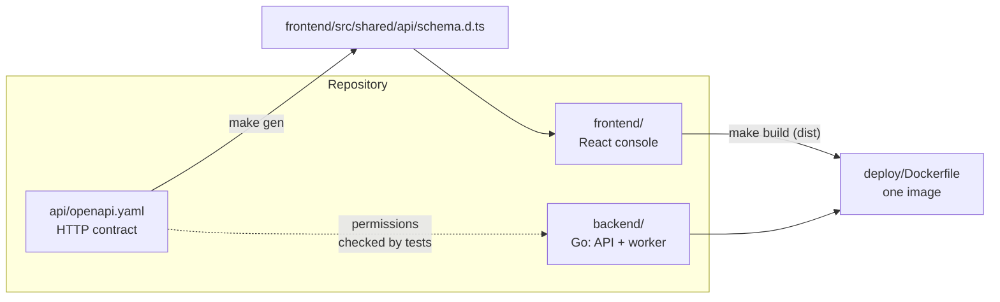
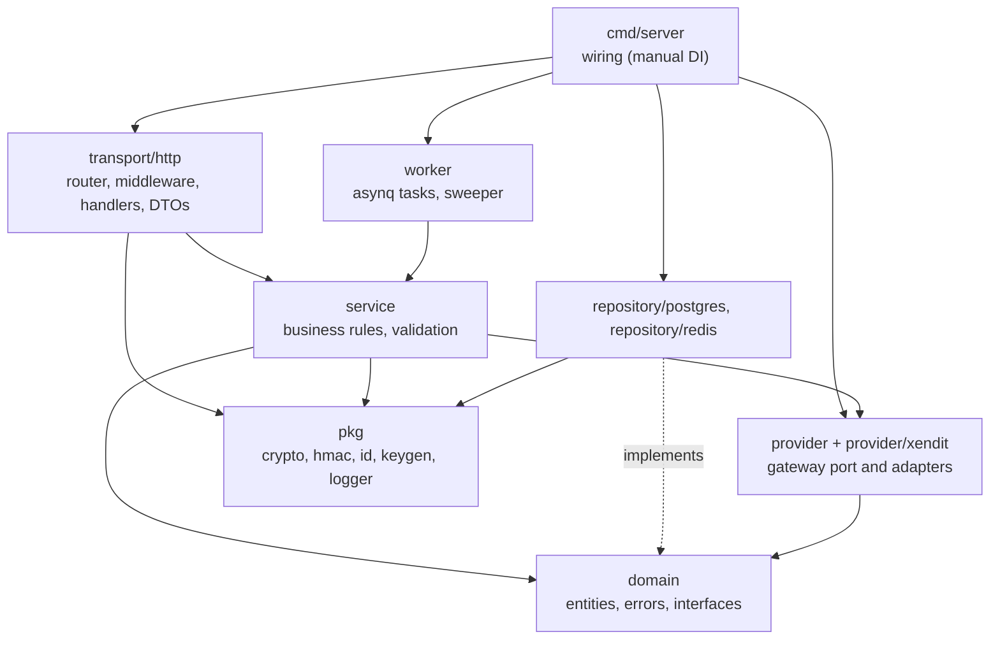
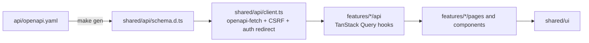

# Project structure

This guide maps the repository for people who want to run KeiPay or change
it. It covers where each piece lives, how a request moves through the code,
and where to start for common changes. For the API and webhook contracts see
the [README](../README.md). For contribution rules see
[CONTRIBUTING.md](../CONTRIBUTING.md), and for console UI rules see
[DESIGN.md](../DESIGN.md).

## The big picture

KeiPay ships as one image and runs as one Go process. That process serves
the JSON API, runs the background worker and serves the built admin console.
Postgres holds the durable state. Redis holds sessions, nonces, rate limits
and the task queues.



| Path | What it is |
|---|---|
| `api/openapi.yaml` | The HTTP contract and the source of truth. Frontend types are generated from it, and backend tests check the admin routes' permissions and the error codes against it. |
| `backend/` | Go module `github.com/mydisha/keipay/backend`: API, worker, migrations. |
| `frontend/` | React 19 + Vite + Tailwind v4 + shadcn/ui admin console. |
| `docs/` | Design notes: [`design.md`](design.md) (multi-gateway design, in Indonesian) and this guide. |
| `deploy/Dockerfile` | Builds the console, the server and the migrate binary into one image. |
| `compose.yaml` | Postgres, Redis, a one-shot migrate job and KeiPay. `asynqmon` is under the `tools` profile. |
| `scripts/ci.sh` | The local pre-merge gate behind `make ci`. |
| `Makefile` | Dev, build, test, generate, CI and Docker targets. Run `make help` for the list. |

## Backend

### Layers

The backend uses a service layer (ports and adapters). Dependencies point
inward: `domain` imports only the standard library, services depend on
`domain` interfaces, and adapters implement those interfaces.



### Directory map

```
backend/
├── cmd/
│   ├── server/            main.go wires config, repositories, services, router and worker
│   └── migrate/           migrations up/down, -seed (demo test app), -reset-admin
├── migrations/            numbered SQL files, each with .up.sql and .down.sql
└── internal/
    ├── config/            environment variables → Config, with validation
    ├── domain/            entities (payment, app, connection, webhook, reconciliation, ...),
    │                      error codes, repository interfaces, money and pagination helpers
    ├── service/           one service per area: payment, webhook, connection, app, auth,
    │                      user, audit, delivery, payment report, reconciliation
    ├── provider/          the gateway port: Provider interface, Registry, credential and
    │   │                  settings schemas, error classes
    │   ├── xendit/        the Xendit adapter (invoices, callbacks, Transactions API)
    │   └── providertest/  a fake adapter for tests
    ├── repository/
    │   ├── postgres/      one repo per aggregate, plus the transaction manager (tx.go)
    │   └── redis/         admin sessions, /v1 nonces, failure counters
    ├── transport/http/
    │   ├── router.go      the only place routes are registered (with their permission)
    │   ├── middleware/    request id, access log, recover, query check, app auth (HMAC),
    │   │                  admin session and CSRF
    │   ├── handler/       thin Gin handlers: parse → call service → respond
    │   ├── dto/           JSON shapes of requests and responses
    │   └── response/      success envelope and the error-code → HTTP status mapping
    ├── worker/            webhook forwarder, reconciliation job, sweeper, enqueuer,
    │                      and the worker pool (one asynq server per queue)
    ├── pkg/               crypto (AES-256-GCM, envelope keys), hmac, id (prefixed ULIDs),
    │                      keygen, logger (zap, secret masking)
    └── testutil/
        ├── memstore/      in-memory repositories for fast service tests
        └── pgtest/        throwaway Postgres schema for integration tests
```

### How a request flows

An app creates a payment:

1. `router.go` sends `POST /v1/payments` through `middleware.AppAuth`. The
   middleware finds the API key by its hash, checks the HMAC signature,
   timestamp and nonce, and puts the app on the context.
2. `handler.PaymentHandler.Create` decodes the body into a DTO and calls
   `service.PaymentService.Create`.
3. The service validates the input, enforces idempotency, picks the app's
   default connection, and calls the gateway through the `provider.Provider`
   from the registry.
4. Repositories in `repository/postgres` store the payment. Errors are
   `domain` errors, and `response.Error` maps them to the JSON envelope.

A gateway callback (`POST /webhooks/{provider}/{con_…}`) goes to
`WebhookService.Process`. In one transaction it applies the status change,
writes the payment report, the event and one delivery per subscribed
endpoint. After the commit it enqueues the deliveries. The worker sends
each one, signs it, and schedules retries from the endpoint's retry policy.

Admin requests (`/admin/...`) pass the session and CSRF middleware. Each
route also declares one permission, which `router.go` checks before the
handler runs.

### Background work

`cmd/server` starts the worker unless `RUN_WORKER=false`.
`worker.StartPool` runs one asynq server per queue:

| Queue | Workers | Task |
|---|---|---|
| `webhooks` | 10 | `webhook:forward`: one delivery attempt to an app endpoint |
| `reconciliation` | 2 | `reconciliation:run`: one reconciliation run against the gateway |

The sweeper re-enqueues deliveries whose next attempt is overdue, for
example after Redis lost a task.

### Where to start

| Change | Files |
|---|---|
| New endpoint | `api/openapi.yaml` → input types in `domain` → logic in `service` → `dto` → `handler` → route in `router.go` → `make gen` |
| New entity or table | domain struct and repository interface → `repository/postgres` → migration in `backend/migrations/` → wire in `cmd/server/main.go` |
| New error code | constant in `domain/errors.go` (and `ErrorCodes`) → status in `response/response.go` → `ErrorCode` in the spec |
| New gateway | a package under `internal/provider/<name>` implementing `provider.Provider` (and `TransactionLister` for reconciliation) → register it in `provider.NewRegistry` in `cmd/server/main.go` |
| New background task | task type and payload in `worker/` → a queue in `worker.StartPool` if it needs its own workers |

### Tests

- Service tests run on `testutil/memstore` and `provider/providertest`, so
  they need no database.
- Tests named `...Integration` use real Postgres or Redis through
  `KEI_TEST_POSTGRES_DSN` and `KEI_TEST_REDIS_ADDR`, and skip without them.
  `make ci` starts both in a throwaway compose project.
- `transport/http` tests drive the real router end to end.
  `router_spec_test.go` checks each admin route's permission against the
  spec, and `response/codes_test.go` checks the error codes.

## Frontend

### Directory map

```
frontend/
├── e2e/                   Playwright specs against the real backend (make e2e)
└── src/
    ├── main.tsx           entry point
    ├── app/               router (routes.tsx), providers, auth guards, global styles
    │   └── layout/        app shell: sidebar, top bar, test-mode banner, command palette
    ├── features/          one folder per area of the console
    │   ├── apps/          apps, API keys, app webhooks and routing
    │   ├── auth/          sign-in, first-run setup, password change
    │   ├── connections/   gateway connections and the create wizard
    │   ├── dashboard/
    │   ├── payments/
    │   ├── reconciliation/ summary, runs, run detail, item resolution
    │   ├── settings/      users and audit log
    │   ├── users/
    │   └── webhooks/      endpoints, deliveries, inbound callbacks
    ├── shared/
    │   ├── api/           openapi-fetch client, CSRF, error helpers, schema.d.ts (generated)
    │   ├── lib/           strings (all UI text), formatting, dates (WIB), mode, hooks
    │   └── ui/            shadcn/ui components and KeiPay building blocks
    │                      (data table, status badge, money and id text, empty/error states)
    └── test/              Vitest setup, fetch mock, fixtures, render helpers
```

### Inside a feature

Each feature uses the same subfolders and only has the ones it needs:

| Folder | Holds |
|---|---|
| `api/` | TanStack Query hooks and query keys over the typed client, for example `useReconciliationRuns` |
| `pages/` | Route components, each with loading, empty and error states |
| `components/` | Pieces used by the pages: tables, dialogs, forms, badges |
| `schemas/` | zod schemas for react-hook-form, with server rule messages |
| `lib/` | Pure helpers such as URL search state and formatting; easy to unit test |

### How data flows



- Types are never written by hand: change the spec, run `make gen`, and
  commit `schema.d.ts`.
- Server state lives in TanStack Query. Forms use react-hook-form with zod.
  Toasts use sonner.
- UI text lives in `shared/lib/strings.ts`, so the console can be
  translated. Numbers and dates use `id-ID` and Asia/Jakarta time.
- Test and Live mode come from `shared/lib/mode.tsx`. The top bar switches
  it, and pages filter by it.

### Where to start

| Change | Files |
|---|---|
| New page | a component in `features/<area>/pages`, a route in `src/app/routes.tsx`, a nav entry in `app/layout/nav.ts` if it belongs in the sidebar |
| New API call | the endpoint in the spec, `make gen`, then a hook in `features/<area>/api` |
| New form | a zod schema in `features/<area>/schemas`, then the form component using `shared/ui/form` |
| New text | `shared/lib/strings.ts` |
| New shared component | `shared/ui`, following [DESIGN.md](../DESIGN.md) |

### Tests

- Vitest and Testing Library tests sit next to the code (`*.test.tsx`).
  `src/test/http.ts` mocks the API by method and path.
- Playwright specs in `e2e/` run against a built console and a real backend
  (`make e2e`, and part of `make ci`).

## Checks before a pull request

```bash
make check   # gofmt, go vet, unit tests, API lint, typecheck, frontend tests
```

```bash
make ci      # everything above plus integration tests, the generated-types drift check and Playwright
```
